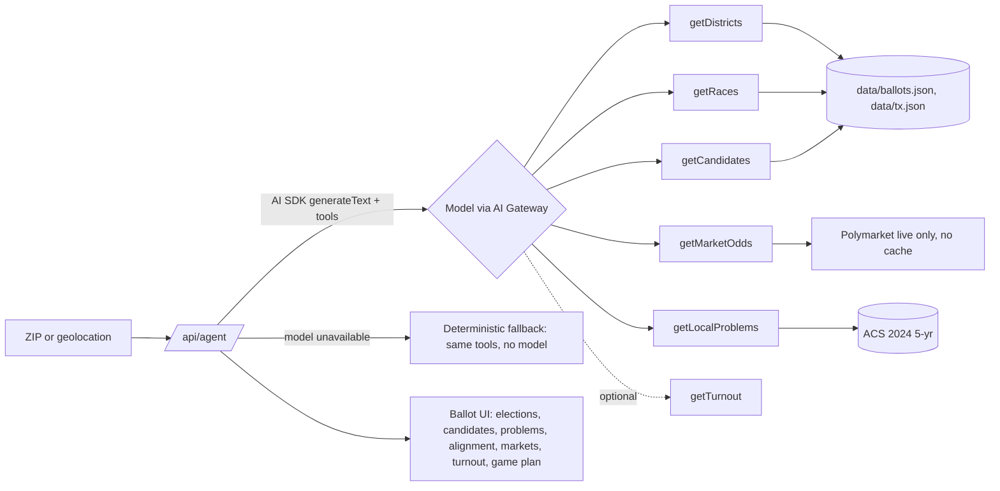

# townhall.town

**Your ballot, explained in seconds.** A nonpartisan ballot agent built for AITX (Oct 29, 2026). Scope: **Austin (78701), San Francisco (94103), New York (10001)**; every other ZIP (including 78130 and 90012, which still have data files) gets "We only cover 78701 (Austin), 94103 (San Francisco) and 10001 (New York) for now." Enter a ZIP and an AI agent calls sourced data tools to explain every race in plain words, show who is running, what each candidate has said about the problems you care about, what prediction markets say, and how to vote.

Live: https://townhall.town

It never picks a "best" candidate. Every claim links to a source; anything unsourced shows **unsure**.

## Quick start
```bash
npm install
cp .env.example .env.local   # optional: without a key the app runs in fallback mode
npm run dev                  # http://localhost:3000
npm run build
```
Try the covered ZIPs: 78701 (Austin), 94103 (San Francisco), and 10001 (New York). No other ZIP is served (lib/site.ts COVERED_ZIPS).
API: `GET /api/agent?zip=78701` streams NDJSON (`status`, `step`, `result`). `POST /api/locate` with `{"lat":..,"lon":..}` maps coordinates to a ZIP via the Census geocoder.

## Open source: contribute

MIT licensed. See [LICENSE](LICENSE). How to run the app, how to add a city, and the sourcing rules are in [CONTRIBUTING.md](CONTRIBUTING.md).

## Stack
Next.js 15 (App Router), React 19, TypeScript, Tailwind, Radix/shadcn-style components, Public Sans. Vercel AI SDK v5 tool loop over the Vercel AI Gateway (OIDC on Vercel). Deployed on Vercel.

## How it works

One model serves every ZIP: `google/gemini-2.5-flash-lite` via the Vercel AI Gateway (the rest of the ladder is only a failover). The UI shows plain steps ("Finding your districts", ...) and a **Live AI agent** or **fallback mode (no model)** label, without model or tool names.

### How the agent works
One request, one bounded tool loop, streamed back to the browser as NDJSON (`app/api/agent/route.ts`).

**Tools the model can call**

| Tool | Returns | Source |
| --- | --- | --- |
| `getDistricts` | U.S. House district(s), state, county for the ZIP | Census 2024 ZCTA centroids in PLANC2333 (TX) |
| `getRaces` | Every race and statewide measure on the Nov 3, 2026 ballot, with what each office controls | `data/ballots.json`, `data/tx.json` |
| `getCandidates` | General-election candidates: name, party, incumbent | Ballotpedia, FEC |
| `getMarketOdds` | Live Polymarket prices per contest, or "no market found" / "unavailable" with no numbers | Polymarket Gamma API (data/markets-map.json), live only |
| `getLocalProblems` | 3 local problems: rent burden, uninsured rate, unemployment | Census ACS 2024 5-year |
| `getTurnout` | County turnout, eligible non-voters, what one ballot counts for (demo ZIPs) | Texas and California Secretary of State, Census Reporter |

**Loop steps**
1. The ZIP must be exactly 5 digits (`/^\d{5}$/`, no trimming or slicing); anything else gets a JSON 400 `{"error":{"code":"invalid","message":"..."}}`. If a valid ZIP isn't covered, the stream returns `unsupported` and stops.
2. The model gets a strict nonpartisan system prompt and is told to call the five core tools in parallel in its first step.
3. `generateText` runs with `stopWhen: stepCountIs(3)` and a 25-second timeout. Each tool call streams a `step` event (running, then done with a one-line summary), which is the live "Agent steps" panel.
4. The model writes a 2 to 3 sentence neutral summary from tool results only. It may not recommend a candidate.
5. If a model fails, the next one in the ladder is tried (`AGENT_MODELS`, default `google/gemini-2.5-flash-lite`, `openai/gpt-4.1-mini`, `openai/gpt-5-nano`, with direct xAI first when `XAI_API_KEY` is set).
6. Any core tool the model skipped is run deterministically, so the ballot is always complete. With no model at all, every tool runs this way and the badge says fallback.
7. A final `result` event carries the mode, model, which tools the model chose to call, the narration, the full ballot and market odds. The UI renders from that.

## Environment variables
See `.env.example` (placeholders only, never commit real values):
- `AI_GATEWAY_API_KEY`: local dev only; on Vercel the gateway authenticates with OIDC.
- `AGENT_MODELS`: optional comma-separated gateway model ladder.
- `XAI_API_KEY`: optional direct xAI fallback.
- `FEC_API_KEY`, `CONGRESS_API_KEY`: optional api.data.gov keys for OpenFEC and Congress.gov. Without them the tools use `DEMO_KEY` (low hourly limit).
- `CENSUS_API_KEY`: optional. Without it `getZipIncomeRent` returns `unavailable`.

### Live data tools (`lib/dataTools.ts`)
Optional tools the model can call, each returning a source URL, or `{ status: "unavailable", reason }` when a key is missing or the call fails:
- `getCampaignFinance`: OpenFEC receipts, spending and cash on hand for a federal candidate.
- `getSponsoredBills`: the current U.S. House member for a state and district, with recent sponsored bills (Congress.gov).
- `getCountyUnemployment`: latest monthly county unemployment rate (BLS LAUS). A county figure, so it differs from the ZIP-level ACS 5-year number.
- `getZipIncomeRent`: median household income (B19013) and median gross rent (B25064) for a ZIP Code Tabulation Area (geo ID prefix 860Z200US), Census ACS 5-year, with margins of error. Needs `CENSUS_API_KEY`; without it returns `unavailable`.

## API
Public, no key. OpenAPI 3.1 spec at [/openapi.json](https://townhall.town/openapi.json), docs with curl examples at [/developers](https://townhall.town/developers), RFC 9727 catalog at `/.well-known/api-catalog`.
- `GET /api/agent?zip=78701` or `POST /api/agent` `{"zip":"78701"}`: NDJSON stream ending in one `result` (or `unsupported`) line.
- `POST /api/locate` `{"lat":30.2672,"lon":-97.7431}`: `{"zip","source"}` from the Census Geocoder. Coordinates go in the body, never the URL; `GET` is 405.
- Every API error is `application/json` `{"error":{"code","message"}}`: 400 `invalid`, 404 `not_found` (also any unknown `/api/*`), 405 `method_not_allowed` (with `Allow`), 502 `upstream_unavailable`.

## Shared data contract
`lib/types.ts` is the shared contract; plug-ins only add optional fields. `lib/turnout.ts` adds jurisdiction `turnout` (county turnout, eligible non-voters, 2026 registration, all sourced), also exposed to the model as a tool via `lib/civicTools.ts`.

## Data

Built Oct 29, 2026 (Central Time) for the AITX hackathon. All files under `data/`. Raw downloads and scripts in `research/` (`gen.py` parse Ballotpedia voteboxes, `cand.py` candidate pages, `build.py` assemble, `markets.py` refresh odds).

## Datasets & provenance
| File | Contents | Source |
|---|---|---|
| `texas/statewide_races.json` | 14 races: U.S. Senate, Governor, Lt Gov, AG, Comptroller, Land Commissioner, Agriculture, Railroad Commission, Supreme Court (CJ, Pl. 7, Pl. 8), Court of Criminal Appeals (Pl. 3, 4, 9). Per candidate: party, incumbent flag, Ballotpedia, campaign & official sites, FEC id (federal), TEC link (state), verbatim "Campaign themes" excerpt. Per race: what the office controls + source | Ballotpedia race & candidate pages; office pages (txcourts.gov, rrc.texas.gov, glo.texas.gov, etc.) |
| `texas/us_house_races.json` | All 38 districts on the 2025 map (PLANC2333) | Ballotpedia district pages; FEC |
| `texas/zip_to_congressional_district.json` | 1,988 TX ZIPs → district | Census 2024 ZCTA gazetteer centroids in PLANC2333 polygons (TX Legislative Council) |
| `texas/tx_congressional_districts_planc2333.geojson` | Simplified district polygons (WGS84) | PLANC2333 shapefile |
| `texas/key_dates.json` | Election Day Nov 3; early voting Oct 19–30; registration deadline Oct 5 (passed); eligibility rules | sos.state.tx.us, votetexas.gov |
| `texas/ballot_measures.json` | None statewide in 2026 | Ballotpedia Texas_elections,_2026 |
| `california/statewide_races.json` | 8 statewide races (no U.S. Senate seat in 2026) | Ballotpedia |
| `california/us_house_races_demo.json` | CA-11, CA-34 only (demo ZIPs) | Ballotpedia |
| `california/ballot_measures.json` | 14 propositions incl. **Prop 40 one-time 5% billionaire wealth tax** (verified on Ballotpedia) | Ballotpedia California_2026_ballot_propositions |
| `markets/snapshot.json` | Archived research snapshot (not used by the app; the app reads Polymarket live only) | gamma-api.polymarket.com |
| `markets/endpoints.json` | How to refresh live + display rule | — |
| `metrics/zip_metrics.json` | For 78130, 78701, 94103, 90012: income, poverty, uninsured, renter cost burden, unemployment, education, rent, home value — vs county, state, US; BLS Sept 2026 county unemployment | ACS 2024 5-yr via Census Reporter; BLS LAUS |
| `demo_zips.json` | Pre-joined bundle for the 4 cached ZIPs | above |

## Candidate photos

- Source: Civic's `data/civic/photos_batch.json` (one entry per candidate id with `photoUrl`, `pageUrl`, `sourceType`, `license`, `attribution`). Run `node scripts/ingest-photos.mjs` after it changes.
- Licensed photos (public domain, CC0, CC BY, CC BY-SA) are resized and self-hosted in `public/portraits`. A candidate's own public campaign or official headshot is allowed even when it is not licensed for reuse; those are hotlinked from their source URL, never copied. No news photos, and never a generated image.
- Every photo carries a small credit, "Photo: {attribution}", linked to its source page.
- `NEXT_PUBLIC_PHOTO_GATE` (build time): `race` (default) shows photos only when every candidate in the race has one; `candidate` shows each candidate's photo where one exists and initials otherwise. To flip without an env var, change `DEFAULT` in `lib/photoGate.ts` (the only switch). A photo that fails to load falls back to initials (per candidate, or per race in race mode).
- **Takedowns:** add the candidate id (e.g. `"rob-bonta"`, the slug of the ballot name) to `data/photo_takedowns.json`, a JSON array. Any id there shows initials everywhere, with no credit. Requests come through /contact (linked from the footer).

## Limitations
- **ZIP ≠ district.** ZIP→district uses the ZIP's center point; ZIPs on a boundary may be wrong. Always say "verify by address" and link VoteTexas / CA voter status. CA ZIP→district (94103→CA-11, 90012→CA-34) is **unverified** under the Prop 50 map.
- **Federal + statewide only.** No state legislature, State Board of Education, county, city, school board, or local measures yet.
- **Incumbent flags** come from Ballotpedia's bold-name convention (Comptroller Don Huffines flagged — verify).
- **FEC matches** are name+district string matches (86/87); verify the ID before showing finance.
- **Positions** are verbatim Ballotpedia excerpts, sometimes including survey boilerplate; many candidates have none. The app must not paraphrase into new claims; "problem ↔ position" links should quote and mark "unsure" when the match is inferred.
- **Market odds** are trader prices, not forecasts or endorsements; thin markets swing. Snapshot is from Oct 29, 2026 ~2:50 PM CT; refresh live.
- **Census** 5-year estimates have margins of error (kept in raw file); small ZCTAs (78701) are noisy.
- Scraped Oct 29, 2026; candidates can withdraw. Not affiliated with any source.

## Next steps
1. **World elections expansion:** same schema (race → office explainer → candidates → sources → market odds) for other countries; Polymarket already lists many non-US elections. Start with upcoming national elections that have markets, plus Wikipedia/official electoral-commission candidate lists.
2. Address-level district lookup (Google Civic Divisions API → OCD-ID, or Census geocoder), down-ballot local races, TEC/FEC finance summaries, Spanish translation.

- Turnout covers the 4 demo counties only.
- **Comptroller:** Don Huffines is shown as the incumbent. Gov. Abbott appointed him after Kelly Hancock resigned; Hancock had lost the March 3 GOP primary to Huffines (Ballotpedia Texas_Comptroller_election,_2026; comptroller.texas.gov lists Huffines).

## Disclaimer
Independent and nonpartisan; not a government website. Always confirm your ballot with official sources: [VoteTexas.gov](https://www.votetexas.gov/), [California Secretary of State](https://www.sos.ca.gov/elections), [CA early voting](https://caearlyvoting.sos.ca.gov/).

## Race labels


"What matters on your ballot" ranks races, never candidates. Score = office impact × competitiveness.

- Office impact: 3 = President, U.S. Senate, Governor; 2 = ballot measure, U.S. House, other statewide executive office; 1.5 = state legislature; 1 = judicial and local.
- Competitiveness: 2 when the published race ratings (Cook Political Report, Sabato's Crystal Ball, Inside Elections, from data/civic/competitiveness.json, each linked on the race) call it a toss-up or tilt, OR when the live Polymarket top contract is between 0.35 and 0.65; otherwise 1. Polymarket can raise a race, never lower a sourced rating; ratings that rested only on another prediction market are dropped. A candidate-race market is shown only if every candidate on the ballot appears in it (`marketCoversBallot`), so a primary-field market (e.g. CA Lieutenant Governor) is hidden. Each race with a shown market gets "Leader on Polymarket: <name> at N%", the market link and the fetch time (CT). No market, no line; nothing cached or estimated.
- Labels: "Most at stake" ≥ 4.5, "High" ≥ 3, "Moderate" ≥ 2, otherwise "Lower", with a one-line legend under the heading. Each race shows a one-line reason plus its race source and market link. Labels apply to races only, never candidates.

Candidate overlap ("Who lines up with you") uses only your slider answers (−5..+5, stored in localStorage) and verbatim sourced stances in data/stances.json. Overlap = (cosine + 1) / 2 on shared issues; hidden below 2 sourced stances ("Not enough record"). It is issue overlap, not a recommendation.

### Questionnaire
- 10 issues (CA adds Prop 40), each a -5..+5 integer slider, one per row with neutral policy-direction labels at both ends; every issue can be skipped.
- Issue-overlap grades (S/A/B/C) are behind `CANDIDATE_GRADES` in lib/grades.mjs (on for this preview): computed only from your Yes/No answers vs sourced positions, never for judicial candidates or without sourced positions, never sorted, and never in the API. Otherwise: With at least 2 sourced stances on your answered issues, a candidate shows "Lines up on N of M compared issues"; otherwise only the count of sourced positions. No answers, no overlap. Ballot order is kept; nothing is labeled "best".
- **Answers stay on your device** (localStorage key `townhall.issueAnswers.v2`). No sign-in, nothing is sent to a server.
